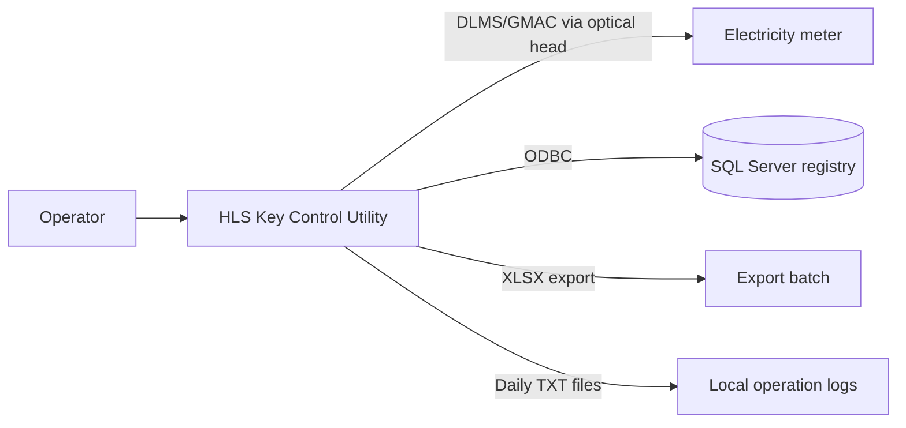
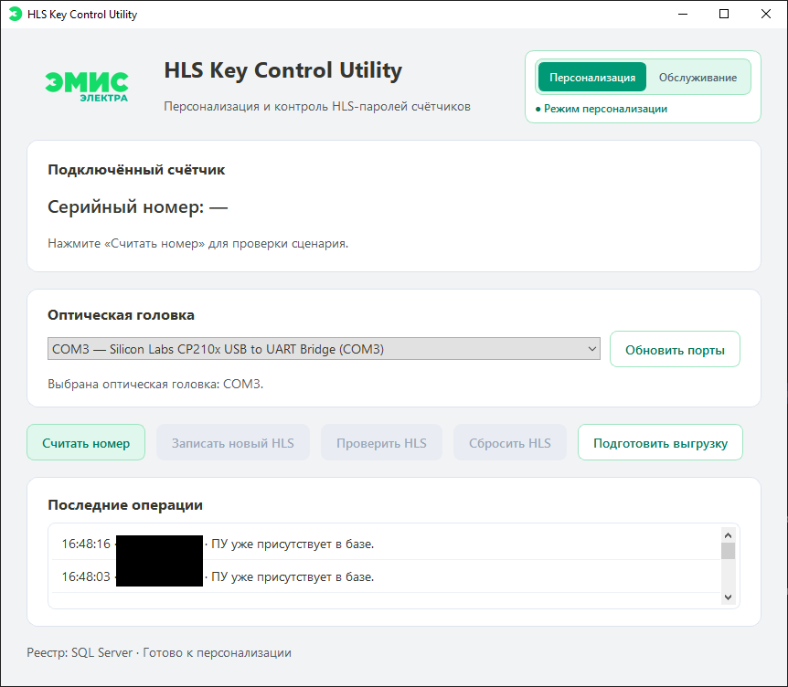
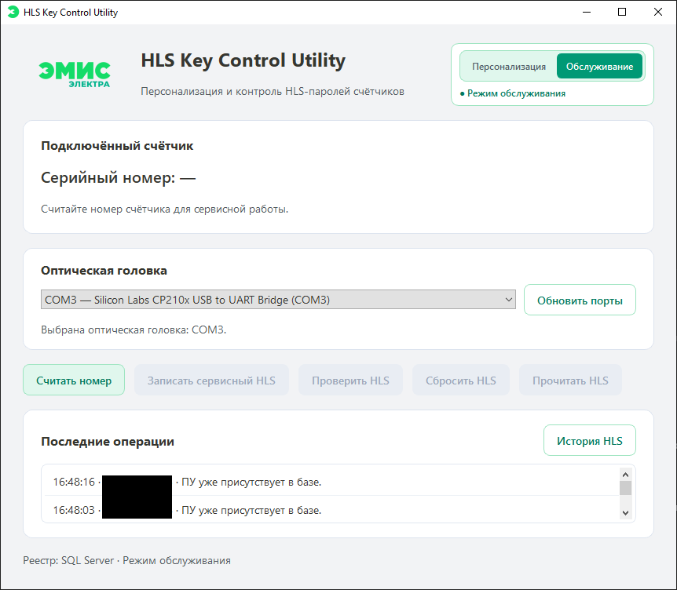
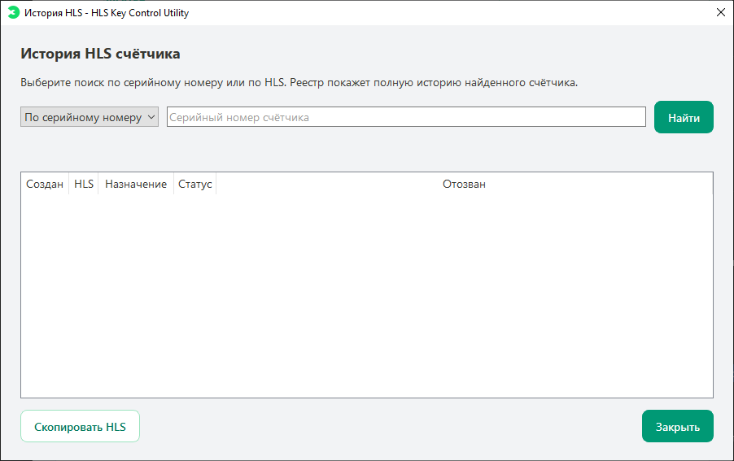
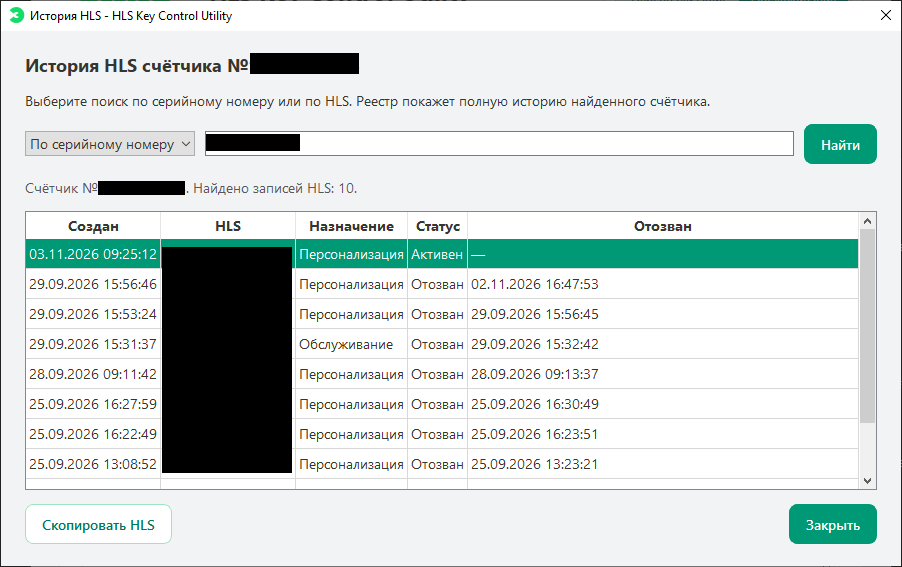
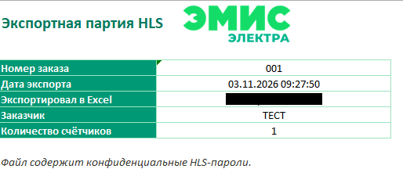

# HLS Key Control Utility

[Русская версия](README.ru.md) · [Changelog](CHANGELOG.md) · [Security](SECURITY.md)

[](https://github.com/Sugo174/HLS-Key-Control-Utility/actions/workflows/checks.yml)
[](LICENSE)

Desktop application for controlled HLS password personalization and maintenance of DLMS/COSEM electricity meters.

The project combines secure HLS lifecycle management, optical-head communication, a shared SQL Server registry, auditable operation history, and Excel export for completed personalization batches.

> This repository contains source code only. It does not contain production HLS passwords, encryption keys, database credentials, exports, logs, or meter-specific configuration.

## Table of Contents

- [Highlights](#highlights)
- [Architecture](#architecture)
- [Technology stack](#technology-stack)
- [Security model](#security-model)
- [Run from source](#run-from-source)
- [Database authentication](#database-authentication)
- [Windows build](#windows-build)
- [Project structure](#project-structure)
- [Project status](#project-status)
- [Media](#media)
- [Contributing](#contributing)
- [License](#license)

## Highlights

- Personalization workflow: generate, write, verify, and register a new HLS password.
- Service workflow: create a service HLS, retrieve application-created service HLS entries, and return a meter to factory HLS.
- Safe recovery: verify the HLS state after an interrupted or uncertain operation.
- DLMS/COSEM communication over an optical serial head, including GMAC authentication support.
- Shared SQL Server registry with meter status, HLS lifecycle status, batch membership, and audit journal.
- HLS history search by meter serial number or by an existing HLS value.
- Export of confirmed personalization HLS entries to a branded Excel workbook.
- Daily local operation logs and portable Windows build support.
- SQL Server authentication and Windows integrated authentication modes.

## Architecture



## Technology stack

- Python 3.11+
- PySide6
- Gurux DLMS / serial libraries
- Microsoft SQL Server and `pyodbc`
- `cryptography` (Fernet encryption and HMAC-SHA256 fingerprints)
- XlsxWriter

## Security model

HLS values are never stored in plain text in SQL Server. The application stores:

- an encrypted HLS value for authorized operational use;
- a keyed HMAC-SHA256 fingerprint for safe exact lookup and duplicate prevention;
- meter association, purpose, lifecycle status, and timestamps.

The local `.env` file contains database settings and HLS protection secrets. It is intentionally excluded from Git. Read [SECURITY.md](SECURITY.md) before configuring or deploying the application.

## Run from source

### Requirements

- Windows 10/11
- Python 3.11 or newer
- Microsoft ODBC Driver for SQL Server
- an optical head supported by the operating system
- access to a configured SQL Server registry

### Setup

```powershell
git clone https://github.com/Sugo174/HLS-Key-Control-Utility.git
cd HLS-Key-Control-Utility
python -m venv .venv
.\.venv\Scripts\Activate.ps1
python -m pip install --upgrade pip
python -m pip install -e .
Copy-Item .env.example .env
```

Fill in the required values in `.env`. Never commit this file.

Start the application:

```powershell
python -m hls_key_control.main
```

## Database authentication

The local `.env` supports two modes:

```dotenv
# SQL Server login
HLS_DB_AUTHENTICATION=sql

# Windows integrated authentication
HLS_DB_AUTHENTICATION=windows
```

With `windows`, the application connects as the Windows user that started it; `HLS_DB_USER` and `HLS_DB_PASSWORD` are ignored.

## Windows build

The application is distributed as a folder build: keep the executable and its `_internal` directory together. The full reproducible build procedure is in [docs/BUILD_WINDOWS.md](docs/BUILD_WINDOWS.md).

The released package intentionally does not contain a production `.env`. Create it locally from `.env.example` and provide approved settings through a secure channel.

## Project structure

```text
src/hls_key_control/       Application code
database/migrations/       SQL Server schema migrations
docs/                      Build and deployment notes
.env.example               Safe configuration template
CHANGELOG.md               Version history
```

## Project status

✔ Core HLS personalization workflow implemented

✔ Service HLS workflow and factory reset implemented

✔ DLMS/GMAC optical-head communication implemented

✔ Shared SQL Server registry, audit journal, HLS history, and Excel export implemented

✔ Concurrent work with a shared registry validated in development

✔ Portable Windows build validated

◐ Migration to a new production SQL Server planned

◐ Stored-procedure rollout for critical registry transactions planned

## Media

### Personalization mode



### Service mode



### HLS history





### Excel export



## Contributing

Contributions and issue reports are welcome. Please read [CONTRIBUTING.md](CONTRIBUTING.md) and never include credentials, real HLS values, meter dumps, production logs, or customer data in an issue or pull request.

## License

MIT License © 2026 Boris Svistunov. See [LICENSE](LICENSE).

For distribution and first-launch instructions, see [Running on Windows](docs/RUN_WINDOWS.md).