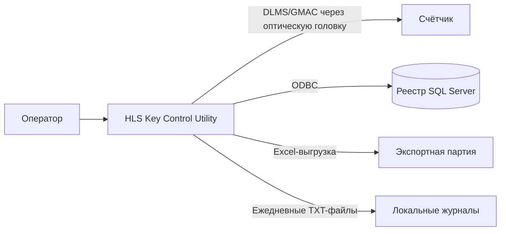
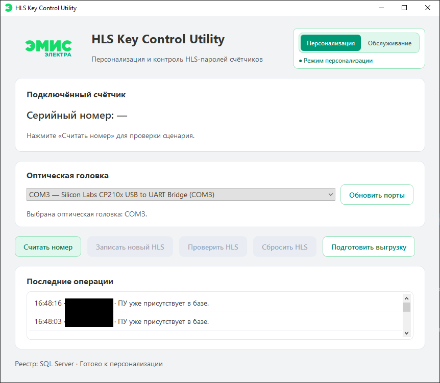
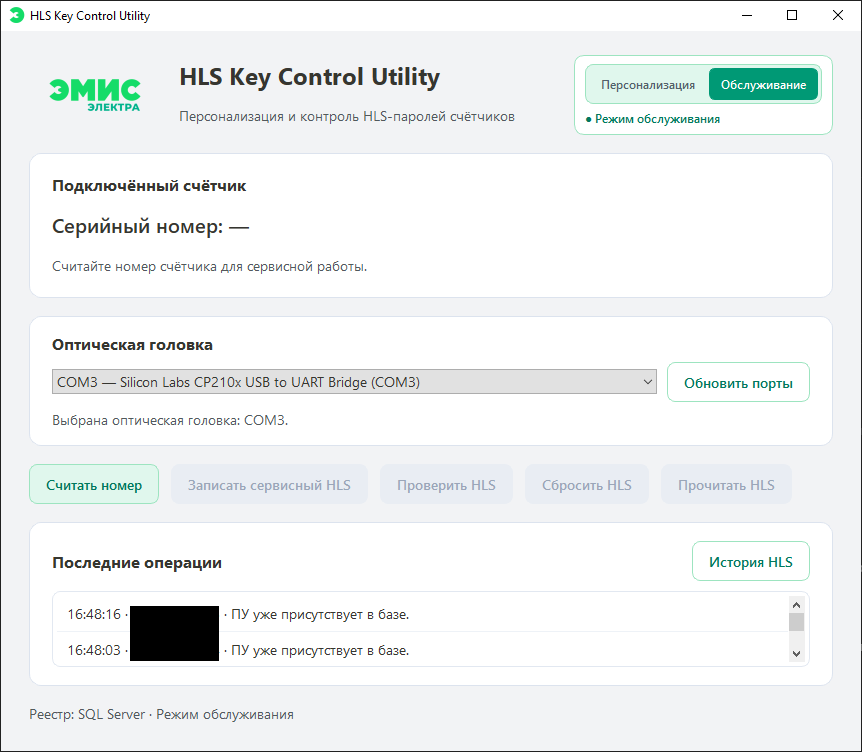
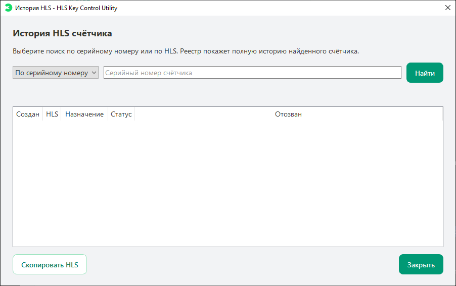
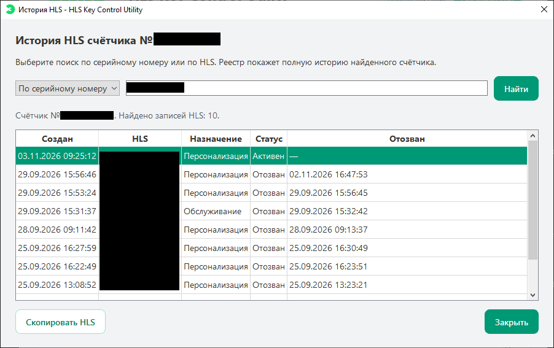
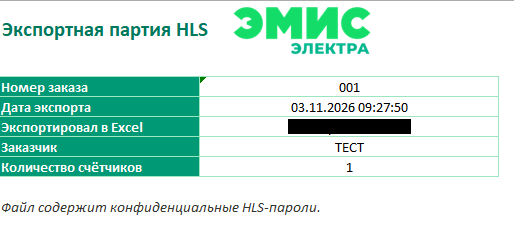

# HLS Key Control Utility

[English version](README.md) · [История изменений](CHANGELOG.md) · [Безопасность](SECURITY.md)

[](https://github.com/Sugo174/HLS-Key-Control-Utility/actions/workflows/checks.yml)
[](LICENSE)

Настольное приложение для контролируемой персонализации HLS-паролей и обслуживания счётчиков электроэнергии с DLMS/COSEM.

Приложение объединяет работу с оптической головкой, безопасный жизненный цикл HLS, общий реестр SQL Server, журнал операций и Excel-выгрузку подтверждённых партий.

> В репозитории нет производственных HLS, ключей шифрования, учётных данных SQL Server, выгрузок, журналов или конфигурации конкретных ПУ.

## Содержание

- [Возможности](#возможности)
- [Архитектура](#архитектура)
- [Быстрый запуск из исходников](#быстрый-запуск-из-исходников)
- [Сборка Windows](#сборка-windows)
- [Статус проекта](#статус-проекта)
- [Скриншоты](#скриншоты)
- [Лицензия](#лицензия)

## Возможности

- Генерация, запись и проверка персонального HLS.
- Сервисный режим: создание сервисного HLS, просмотр сервисного HLS, созданного приложением, и возврат к заводскому HLS.
- Проверка состояния HLS после неопределённой операции.
- Обмен DLMS/COSEM через оптическую головку, включая GMAC-аутентификацию.
- Общий SQL Server-реестр ПУ, HLS, статусов, экспортных партий и операций.
- Поиск полной истории HLS по серийному номеру или по самому HLS.
- Брендированная Excel-выгрузка подтверждённых персональных HLS.
- Ежедневный локальный журнал операций.
- Поддержка SQL- и Windows-аутентификации SQL Server.

## Архитектура



## Быстрый запуск из исходников

Требуются Windows 10/11, Python 3.11+, Microsoft ODBC Driver for SQL Server, оптическая головка и доступ к настроенному реестру SQL Server.

```powershell
git clone https://github.com/Sugo174/HLS-Key-Control-Utility.git
cd HLS-Key-Control-Utility
python -m venv .venv
.\.venv\Scripts\Activate.ps1
python -m pip install --upgrade pip
python -m pip install -e .
Copy-Item .env.example .env
python -m hls_key_control.main
```

Перед запуском заполните `.env`. Этот файл содержит локальные настройки и секреты, поэтому он исключён из Git.

## Сборка Windows

Инструкция для воспроизводимой Windows-сборки находится в [docs/BUILD_WINDOWS.md](docs/BUILD_WINDOWS.md). Архив релиза не содержит рабочего `.env`: его создают локально из `.env.example` и заполняют утверждёнными настройками.

## Статус проекта

✔ Реализован основной сценарий персонализации HLS

✔ Реализованы сервисный HLS и возврат к заводскому HLS

✔ Реализован DLMS/GMAC-обмен через оптическую головку

✔ Реализованы общий реестр SQL Server, журнал операций, история HLS и Excel-выгрузка

✔ Проверена параллельная работа с общим реестром в среде разработки

✔ Проверена переносимая Windows-сборка

◐ Запланирован перенос на новый производственный SQL Server

◐ Запланирован поэтапный переход критичных операций реестра на хранимые процедуры SQL Server

## Скриншоты

### Режим персонализации



### Режим обслуживания



### История HLS





### Excel-выгрузка



## Лицензия

MIT License © 2026 Boris Svistunov. Полный текст — в [LICENSE](LICENSE).
